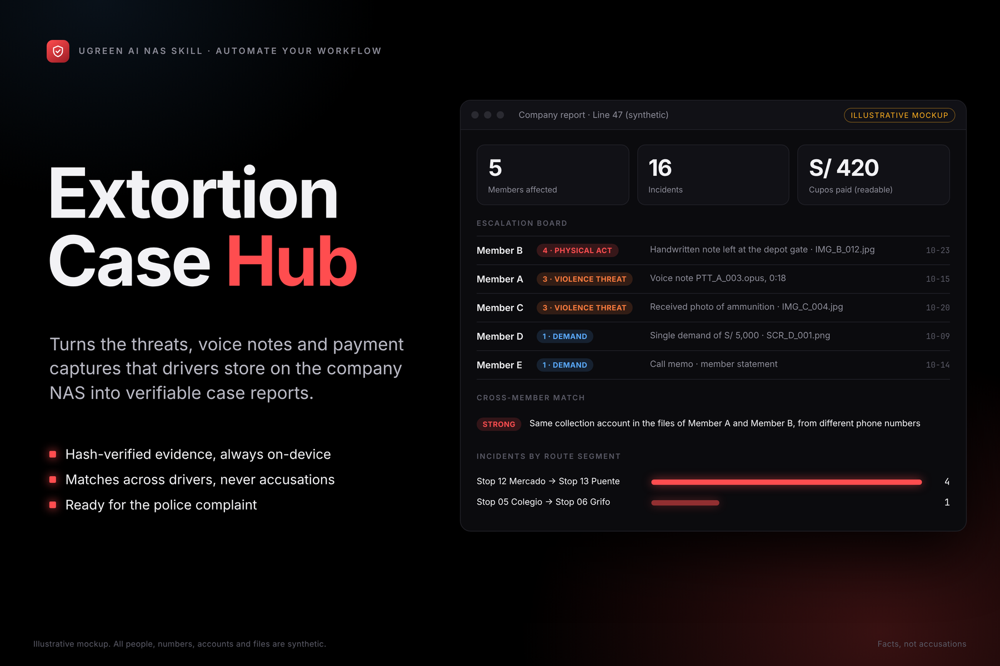
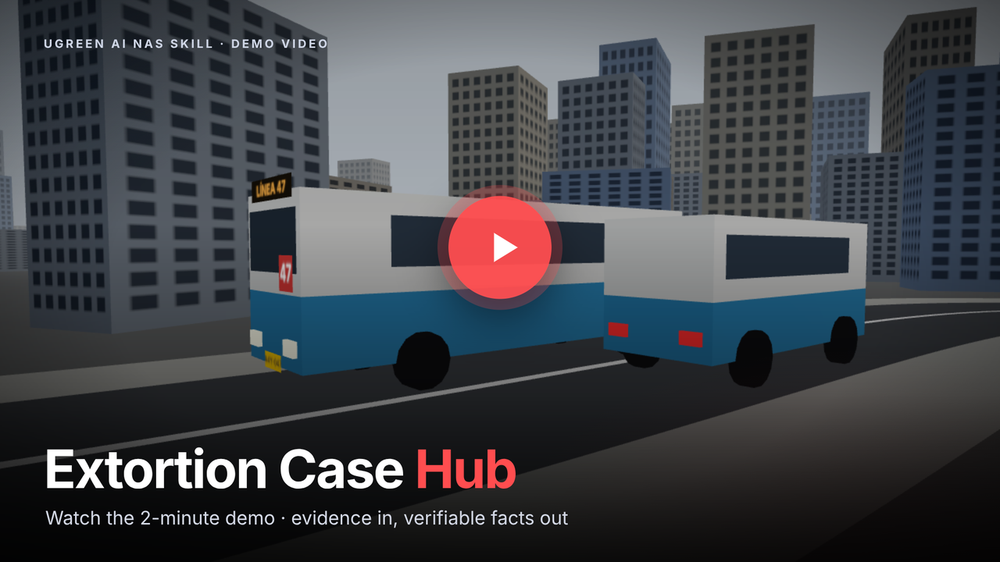
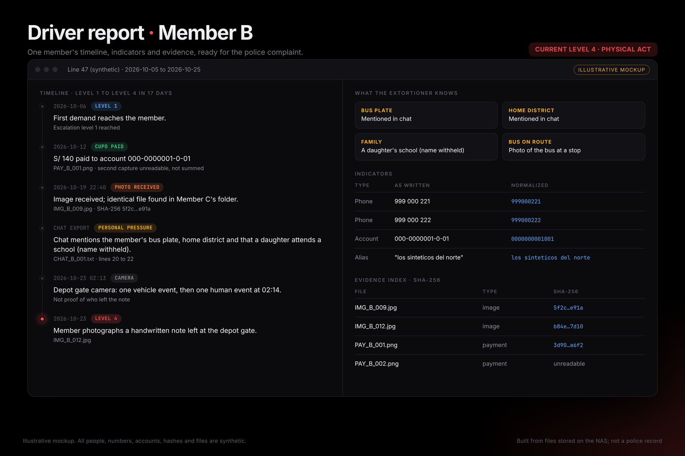
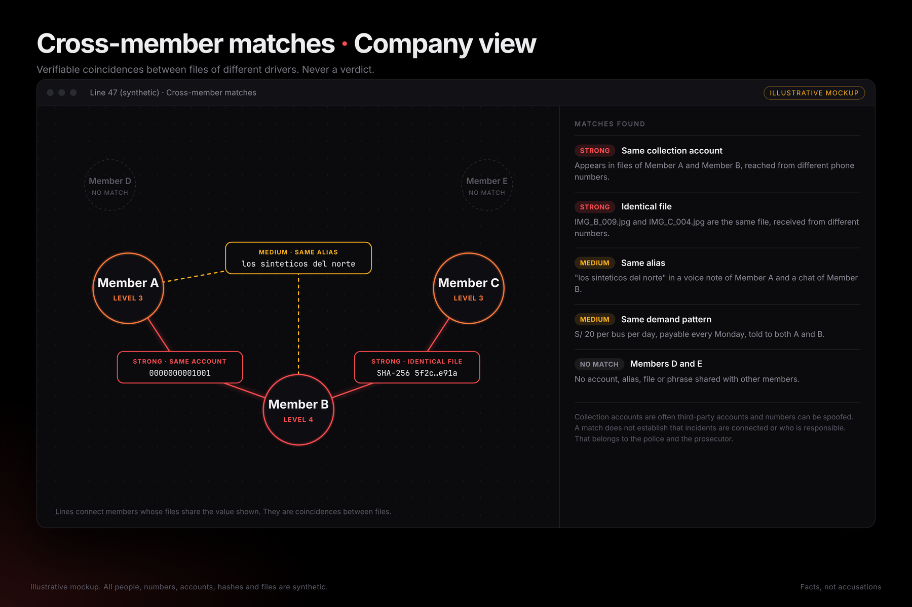
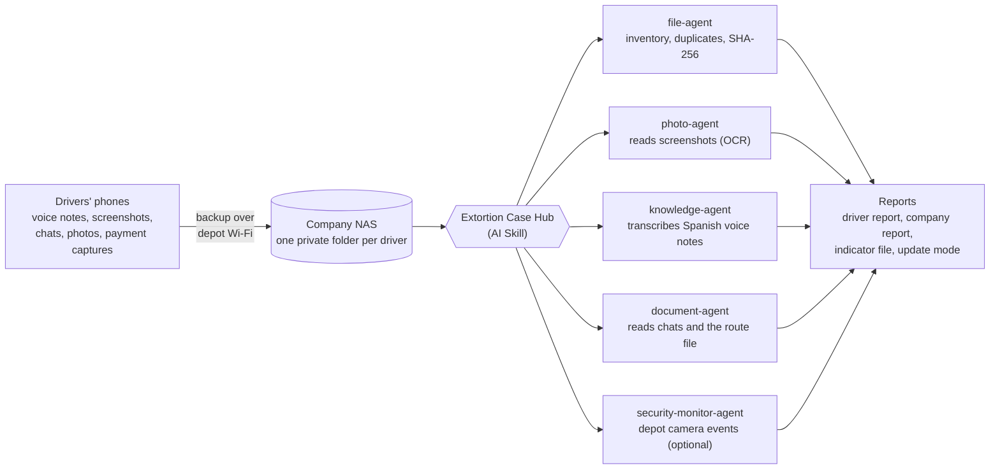

<div align="center">



# Extortion Case Hub

### Evidence in. Verifiable facts out.

**A private AI Skill for the UGREEN AI NAS that helps bus companies turn extortion threats into reports the police can actually use.**


[**Watch the 2-minute demo**](https://www.youtube.com/watch?v=JxxjrwvxM5M) ·
[Read the proposal (PDF)](Extortion-Case-Hub_Round1-Proposal.pdf) ·
[Skill package (ZIP)](extortion-case-hub.zip) ·
[Open the Skill source](extortion-case-hub/SKILL.md)

</div>

---

## In 30 seconds

> **Who it is for.** The roughly 400 private bus companies of Lima and Callao (Peru). Most of them are forced to pay a daily "protection fee" (a *cupo*) to criminal gangs.
>
> **The problem.** The threats arrive as voice notes and messages on drivers' personal phones, from numbers that are thrown away. Drivers delete them out of fear. When someone finally reports, the police receive loose files they cannot verify or connect.
>
> **What this project does.** The company keeps a small server at its depot (a **UGREEN AI NAS**). Drivers' phones back up their threats there. On request, our **AI Skill** reads everything and writes clear reports with a tamper-proof fingerprint for every file, and it shows which drivers received *the same* threat, account or file.
>
> **What it never does.** It never names suspects, never contacts anyone, never tells anyone to pay, and never files the complaint. It reports **facts that can be checked**, never accusations. And **nothing leaves the NAS**.

New to the topic? Skip to the [glossary](#glossary).

---

## Watch the demo

<div align="center">

[](https://www.youtube.com/watch?v=JxxjrwvxM5M)

*2 minutes. An illustrative animation with synthetic data; the narration is an AI-generated voice.*

</div>

---

## Table of contents

1. [The problem](#the-problem)
2. [The idea](#the-idea)
3. [See it](#see-it)
4. [How it works](#how-it-works)
5. [The escalation ladder](#the-escalation-ladder)
6. [What it never does](#what-it-never-does)
7. [Why a NAS and not a cloud chatbot](#why-a-nas-and-not-a-cloud-chatbot)
8. [Current status (honest version)](#current-status-honest-version)
9. [Validation plan](#validation-plan)
10. [Known limitations](#known-limitations)
11. [Repository map](#repository-map)
12. [How to review this project](#how-to-review-this-project)
13. [Glossary](#glossary)

---

## The problem

In Lima and Callao, most public transport is run by hundreds of private companies. Each one holds a fixed route and operates dozens of microbuses. Criminal groups charge these companies a daily **cupo** (protection money) per bus, and attack the buses and depots of those who refuse.

The demands arrive as WhatsApp voice notes and messages from disposable numbers, photos of the bus or the driver's family, letters left at the depot and phone calls.

| Why reporting falls short today | What happens |
|---|---|
| Evidence is scattered | It sits on many personal phones, and drivers delete it out of fear |
| Numbers keep changing | Every complaint looks like an isolated case |
| Nothing can be verified | The police receive a pile of loose files, with no order and no proof of integrity |

**The scale** (public figures; see [`peru-context.md`](extortion-case-hub/references/peru-context.md) for sources):

- **26,585** extortion complaints in Peru in 2025, up from 22,361 in 2024.
- More than **85,000** complaints produced only **20 sentences** in five years.
- Transport leaders estimate about **80%** of the roughly **400** urban transport companies in Lima and Callao are extorted, often by several groups at once.

---

## The idea

A company cannot stop the gangs, but it **can control the quality of its own evidence**.

> **A day in the life.** A driver gets a threatening voice note. His phone already backs up his chat media to a private folder on the depot's NAS, so the file is safe even if he deletes it. After a threatening call, he records a short voice memo describing it. At the end of the week the manager asks for the company report. The Skill reads every file, fingerprints the originals, and writes the report, including what it could *not* read.

The Skill then produces four things:

| Output | For whom | What it contains |
|---|---|---|
| **Driver report** | The driver and the police | Timeline, verbatim threats, indicators, escalation level, cupos paid and a SHA-256 evidence index, ready for a police complaint |
| **Company report** | The company manager | Cross-driver matches (same collection account, identical file, same alias or demand pattern), an escalation level per driver, total cupos paid and incidents per route segment |
| **Indicator file** | Other transport companies | An anonymized list another company can cross-check on its own NAS. No victim names, no files |
| **Update mode** | Everyone | Only what is new since the previous report |

---

## See it

> The images below are **illustrative mockups with synthetic data** (a fictional "Line 47"). The Skill works through chat on the NAS; these show what its reports contain.

### One driver's report



A timeline from the first demand to a physical act, what the extortioner knows about the driver, the indicators found and a fingerprint (SHA-256) for every file.

### Matches between drivers



The same collection account in the files of two drivers, the same file received by two drivers, or the same alias. Each match is graded **strong** or **medium**. Drivers with no match are shown as such.

---

## How it works

The Skill is the *conductor*. It never touches files itself: it hands each job to a specialist agent that already lives on the UGREEN AI NAS, and passes only real results from one step to the next.



| Expert agent | What it does | Workflow step |
|---|---|---|
| `file-agent` | Inventory, cross-folder duplicate scan, SHA-256, approved copy with checksum verification | 1, 6, 9 |
| `photo-agent` | OCR and neutral description of screenshots, photos and payment captures | 2 |
| `knowledge-agent` | Spanish transcription of voice notes, saving reports, reading indicator files | 3, 9, 10 |
| `document-agent` | Cited extraction from exported chats, documents and the route file; formal draft for the complaint | 4, 8 |
| `security-monitor-agent` | Optional: depot camera events near the time of an in-person incident | 5 |

User accounts, per-driver folder permissions and phone backup over the depot Wi-Fi are native NAS features. All read steps run before any write, and every write waits for platform approval.

### Core user flow

1. Drivers' phones back up chat media to private NAS folders over depot Wi-Fi. After a threatening call, the driver records a short voice memo.
2. The manager asks the assistant (Uliya) for the company report.
3. The Skill confirms folders and period, runs the read steps and shows the report, including gaps.
4. After platform approval, it saves the report and copies the originals, verifying every checksum.

### Why it connects cases differently

Chatbots need victims' evidence uploaded to a cloud. Police portals receive complaints but do not connect them. This Skill links cases through what extortioners **cannot easily change** (collection accounts, identical files, aliases, demand patterns), not through disposable phone numbers, across drivers and, through the anonymized indicator file, across companies.

---

## The escalation ladder

Each driver gets the highest level supported by at least one cited item. Every level is shown with the quote or image that justifies it. **Facts only, no predictions.**

| Level | Name | Evidence that qualifies |
|:---:|---|---|
| **1** | Demand | A request for money or a cupo, without explicit violence |
| **2** | Personal pressure | The threat mentions the driver's plate, route, schedule, family or home |
| **3** | Explicit violence threat | Words or images that threaten death, injury, fire or shooting |
| **4** | Physical act | Evidence that something happened: shots at a bus or depot, a note left in person, a damaged vehicle, an injured person, or a camera event the driver links to the incident |

More detail: [`escalation-ladder.md`](extortion-case-hub/references/escalation-ladder.md).

---

## What it never does

- **A match is a verifiable fact, never a conclusion.** It does not establish that incidents are connected or who is responsible; that belongs to the police and the prosecutor.
- It never names or identifies suspects, never contacts anyone and never advises paying, negotiating or confronting.
- It never files the complaint.
- It never deletes, moves, edits or renames an original file; it only copies.
- Pseudonyms by default; it respects NAS folder permissions (a driver can only obtain their own report).
- Unreadable or inaudible material is marked as such. **Nothing is invented.**
- In case of immediate danger, it first tells the user to call the police or emergency services.

---

## Why a NAS and not a cloud chatbot

The value comes from four things working **together**, which a generic chatbot cannot offer:

| | On a UGREEN AI NAS | In a cloud chatbot |
|---|---|---|
| **Privacy** | Victims' evidence stays in-house; all processing is local | Evidence is uploaded to a third party |
| **Volume** | Months of audios, screenshots and photos in local storage | Upload limits, repeated uploads |
| **Multi-user folders** | One private folder per driver, with permissions | A single shared conversation |
| **Evidence integrity** | Originals are fingerprinted and never modified | No chain of custody |

---

## Current status (honest version)

| | |
|---|---|
| **Implemented** | The full Skill package (`SKILL.md` plus seven references) passes the official Uliya Skill Kit static checker with **0 errors and 0 warnings**. It includes the match rules, the escalation ladder, a complete synthetic example and a validation plan with known expected results |
| **Not implemented** | **Nothing has run on a real NAS yet.** The demo video and the mockups are illustrative animations with synthetic data |
| **Pending validation** | Spanish transcription quality, batching, approval flows and camera events, if selected as a Finalist |

---

## Validation plan

A synthetic five-driver data set with planted answers, all marked "SYNTHETIC TEST".

- **Core test 1:** exactly two strong matches are found (a shared collection account and an identical image) and none for two unrelated drivers.
- **Core test 2:** a full report is produced, then saved and the originals copied after approval, with every checksum matching its original.
- **Edge case:** an inaudible audio, an undated screenshot, an ambiguous bus stop and a restricted account. Gaps are listed, nothing is invented and the restricted driver obtains only their own report.

Details: [`validation-plan.md`](extortion-case-hub/references/validation-plan.md). A complete worked example: [`synthetic-example.md`](extortion-case-hub/references/synthetic-example.md).

---

## Known limitations

- No voice or face biometrics.
- A match suggests, but never proves, a link: accounts can be borrowed and numbers spoofed.
- Transcription quality for slang-heavy Spanish is unverified.
- Phone calls and view-once messages are not captured; a call is only documented through the driver's own voice memo.
- File hashes support, but do not replace, official forensic examination.
- Drivers must choose to upload their files.
- Assumes the company or its association keeps a UGREEN AI NAS at the depot. This is an adoption assumption, not an observed fact.
- No external dependencies, and no data flows outside the NAS.

---

## Repository map

```text
.
├── README.md                                  <- you are here
├── Extortion-Case-Hub_Round1-Proposal.pdf     <- Round 1 proposal (ten answers)
├── extortion-case-hub.zip                     <- the Skill package, exactly as submitted
├── extortion-case-hub/                        <- the Skill source
│   ├── SKILL.md                               <- the Skill itself (entry point)
│   └── references/                            <- seven supporting documents
└── docs/
    ├── index.html                             <- project web page (GitHub Pages)
    ├── pitch-script.md                        <- narration of the demo video
    └── assets/                                <- images used in this README and the web page
```

The Skill package contains only original Markdown files: no scripts, executables, binaries, third-party code, models, media or datasets. All example data is synthetic.

| Reference inside the Skill | Purpose |
|---|---|
| [`case-report-format.md`](extortion-case-hub/references/case-report-format.md) | Layout of the three outputs and indicator normalization |
| [`cross-case-rules.md`](extortion-case-hub/references/cross-case-rules.md) | Match strength, wording, false-positive warnings, route segments |
| [`escalation-ladder.md`](extortion-case-hub/references/escalation-ladder.md) | The four evidence-based escalation levels |
| [`synthetic-example.md`](extortion-case-hub/references/synthetic-example.md) | A complete synthetic company report |
| [`validation-plan.md`](extortion-case-hub/references/validation-plan.md) | Test cases with known expected results |
| [`peru-context.md`](extortion-case-hub/references/peru-context.md) | Background for readers outside Peru |
| [`setup-and-roles.md`](extortion-case-hub/references/setup-and-roles.md) | NAS setup, roles, phone backup and the route file |

---

## How to review this project

| If you have... | Do this |
|---|---|
| **2 minutes** | [Watch the demo](https://www.youtube.com/watch?v=JxxjrwvxM5M) |
| **5 minutes** | Read this page, then the [synthetic example](extortion-case-hub/references/synthetic-example.md) to see a finished report |
| **15 minutes** | Read the [proposal PDF](Extortion-Case-Hub_Round1-Proposal.pdf) and the [Skill](extortion-case-hub/SKILL.md) with its [match rules](extortion-case-hub/references/cross-case-rules.md) |

---

## Glossary

| Term | In plain words |
|---|---|
| **Skill** | A set of instructions that teaches the NAS's AI assistant how to do one job. Here it is Markdown only, with no code |
| **NAS** | *Network-attached storage*: a small private server a company keeps in its own office. The **UGREEN AI NAS** adds a local AI assistant |
| **Cupo** | Slang for the "protection money" criminal groups charge, usually per bus per day |
| **SHA-256 / hash** | A fingerprint of a file. If even one pixel changes, the fingerprint changes. Two files with the same fingerprint are identical |
| **Collection account** | The bank account, wallet or QR code a victim is told to pay into |
| **Indicator** | A value that can be compared across cases: an account, a file fingerprint, an alias, a demand pattern |
| **Evidence index** | The list of every file in a report, with its fingerprint, type and original date |
| **Escalation level** | A 1 to 4 scale, justified by the threat text or image, from "demand" to "physical act" |
| **Synthetic** | Invented on purpose. All examples, names, numbers and files in this project are synthetic |

---

## Built with

UGREEN AI NAS, UGOS, the official UGREEN Skill Developer Package (Uliya Skill Kit 0.7.7) and its static checker, and Markdown. The demo video was made with Three.js and FFmpeg.

<div align="center">

*Built for the UGREEN Hackathon 2026 on AI NAS · Track: Automate Your Workflow · Skill name: `extortion-case-hub`*

</div>
